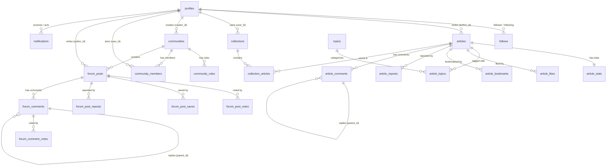

# Tel-U Knowledge - Frontend

Aplikasi frontend portal pengetahuan Telkom University berbasis **Next.js 16** (App Router & Turbopack), **React 19**, **TypeScript**, **Tailwind CSS 4**, **shadcn/ui**, **TanStack Query v5**, **Tiptap**, dan **Zod**.

---

## 1. Set Up Frontend (FE)

### Prasyarat
- **Node.js** v20+ dan **npm**
- (Opsional) Backend NestJS Tel-U Knowledge untuk mode API live, atau gunakan `json-server` bawaan untuk mode mock lokal.

### Langkah Instalasi

1. **Masuk ke direktori frontend dan install dependencies:**
   ```bash
   cd telu-knowledge
   npm install
   ```

2. **Konfigurasi Environment Variables:**
   Salin file `.env.example` menjadi `.env`:
   ```bash
   cp .env.example .env
   ```

   | Variabel | Tipe | Wajib | Keterangan |
   |---|---|---|---|
   | `API_BASE_URL` | String | Ya | URL dasar backend NestJS (server-only, default: `http://localhost:3002`). Jangan tambahkan `/api` atau prefix `NEXT_PUBLIC`. |
   | `MOCK_API_BASE_URL` | String | Ya | URL server mock `json-server` saat request menggunakan data source `mock` (default: `http://localhost:4000`). |
   | `APP_ORIGIN` | String | Ya | Origin publik frontend (default: `http://localhost:3000`). Dipakai untuk proteksi CSRF Same-Origin dan basis URL redirect. |
   | `TRUSTED_IP_HEADER` | String | Opsional | Header IP khusus dari reverse proxy tepercaya (`cf-connecting-ip`, `x-vercel-forwarded-for`, `x-real-ip`). |
   | `TRUSTED_PROXY_HOPS` | Number | Opsional | Jumlah hop proxy tepercaya pada `X-Forwarded-For` dari kanan (default: `0`). Dipakai bila `TRUSTED_IP_HEADER` kosong. |
   | `SUPABASE_IMAGE_HOST` | String | Opsional | Hostname Supabase Storage untuk konfigurasi `next/image` `remotePatterns` (tanpa `https://`). |

3. **Jalankan Development Server:**
   - **Frontend Next.js** (`http://localhost:3000`):
     ```bash
     npm run dev
     ```
   - **Mock API Server** (`http://localhost:4000`, jalankan di terminal terpisah untuk modul yang memakai `source: "mock"`):
     ```bash
     npm run mock:server
     ```

### Daftar Script Tersedia

| Perintah | Fungsi |
|---|---|
| `npm run dev` | Menjalankan Next.js development server (`http://localhost:3000`). |
| `npm run build` | Membangun bundle produksi Next.js. |
| `npm run start` | Menjalankan hasil build produksi. |
| `npm run lint` | Menjalankan pemeriksaan ESLint. |
| `npm run mock:server` | Menjalankan mock REST API `json-server` (`mock/server.mjs` di port `4000`). |
| `npm run mock:validate` | Memvalidasi integritas schema & relasi `mock/mock_data.seed.json`. |
| `npm run api:types` | Menghasilkan ulang tipe OpenAPI backend ke `src/lib/api/schema.d.ts` (membutuhkan backend aktif di port `3002`). |

### Checklist Pengaturan Supabase & Produksi
- **Supabase Auth**: Aktifkan *Confirm email* pada **Authentication → Providers → Email**, daftarkan Redirect URL (`/auth/callback` dan `/reset-password`) di **URL Configuration**, serta aktifkan Custom SMTP agar tidak terkena batas kuota email default.
- **Produksi**: Pastikan `APP_ORIGIN` sesuai domain HTTPS publik (cookie `tk_access`, `tk_refresh`, `tk_remember` otomatis memakai `secure: true` saat `NODE_ENV=production`), dan selaraskan `TRUSTED_IP_HEADER` / `TRUSTED_PROXY_HOPS` dengan konfigurasi `trust proxy` di backend NestJS.

### Repository Backend
Repository backend NestJS untuk proyek ini dapat diakses di:
- **Backend Repository:** [https://github.com/Vastuolu/telu-knowledge-backend](https://github.com/Vastuolu/telu-knowledge-backend)

---

## 2. Hierarki Folder

```text
telu-knowledge/
├── mock/
│   ├── mock_data.seed.json          # Database JSON seed untuk json-server (22 tabel)
│   └── server.mjs                   # Custom express/json-server dengan response envelope & endpoints kustom
├── public/                          # Aset statis (gambar, ikon, ilustrasi)
├── scripts/
│   └── validate-mock.mjs            # Validator integritas schema, FK, tipe data, dan PII pada seed mock
├── src/
│   ├── proxy.ts                     # Middleware/proxy Next.js untuk penjagaan rute & cookie sesi
│   ├── app/                         # Next.js App Router (Halaman, Layout, Error Boundaries, & BFF API)
│   │   ├── (auth)/                  # Route group halaman publik otentikasi (login, register, forgot/reset, callback)
│   │   ├── (editor)/                # Route group halaman editor artikel (editor-studio, editor-studio/[id])
│   │   ├── (main)/                  # Route group halaman utama terautentikasi (home, artikel, forum, komunitas, profil, dll.)
│   │   ├── api/
│   │   │   ├── auth/                # BFF Route Handlers otentikasi & pengelolaan cookie httpOnly
│   │   │   └── proxy/[...path]/     # BFF Reverse Proxy menuju NestJS Backend atau Mock Server
│   │   ├── error.tsx                # Root Error Boundary
│   │   ├── global-error.tsx         # Global Error Boundary (fallback root layout)
│   │   ├── layout.tsx               # Root layout & QueryProvider / ToastProvider
│   │   ├── not-found.tsx            # Halaman 404 kustom
│   │   └── page.tsx                 # Entry route (`/`)
│   ├── components/
│   │   ├── ui/                      # Primitif UI dari shadcn/ui (button, dialog, input, tabs, toast, dll.)
│   │   ├── _layouts/                # Kerangka tata letak halaman (AuthLayout, EditorLayout, MainLayout)
│   │   ├── _shared/                 # Komponen custom reusable lintas halaman (ArticleCard, ForumPostCard, FormAlert, dll.)
│   │   └── _views/                  # Komponen tampilan spesifik per fitur/halaman:
│   │       ├── Articles/            # ArticleDetail, DiscoverArticles, MyArticles
│   │       ├── Auth/                # AuthCallback, ForgotPassword, Login, Register, ResetPassword
│   │       ├── Communities/         # CommunityDetail, CommunityPostCreate, CommunityPostEdit, CreateForum
│   │       ├── EditorStudio/        # Editor artikel Tiptap, cover, subtitle, title, & panel AI Assist
│   │       ├── Forums/              # DiscoverForums, DiscussionForumDetail, DiscussionForums, MyForums
│   │       ├── Home/                # Beranda feed artikel & rekomendasi
│   │       ├── Libraries/           # Halaman simpanan / koleksi artikel
│   │       ├── Notifications/       # Halaman daftar notifikasi
│   │       ├── Profiles/            # Profil pengguna, EditProfile, FollowListDialog, DeleteAccount
│   │       └── Settings/            # Pengaturan akun
│   ├── hooks/                       # Custom React hooks global (use-cooldown, useDraftAutosave)
│   ├── lib/
│   │   ├── api/                     # apiFetch client, serverFetch, error parser/messages, origin validator, schema OpenAPI
│   │   ├── auth/                    # Utilitas cookie httpOnly, path allowlist, dan session helper
│   │   ├── query/                   # Konfigurasi TanStack QueryClient & QueryProvider
│   │   ├── clipboard.ts             # Helper salin teks ke clipboard dengan fallback
│   │   ├── constants.ts             # Konstanta global aplikasi
│   │   ├── env.ts                   # Validasi & pembacaan environment variables
│   │   ├── formatters.ts            # Formatter tanggal (formatDate, formatDateTime) & angka ringkas (formatCounter)
│   │   └── utils.ts                 # Helper utilitas CSS/Tailwind (`cn`)
│   └── services/                    # Layer integrasi API per domain (konvensi seragam: .types, .schemas, .api, .queries)
│       ├── ai/                      # Layanan AI writing assistant
│       ├── articles/                # Artikel, komentar artikel, & repost artikel
│       ├── auth/                    # Otentikasi & manajemen sesi
│       ├── communities/             # Komunitas/forum, postingan komunitas, komentar forum, & repost forum
│       ├── profiles/                # Profil pengguna, follow list, & hapus akun
│       └── recommendations/         # Rekomendasi topik, penulis, & komunitas aktif
├── .env.example
├── package.json
└── README.md
```

---

## 3. Modul-Modul Aplikasi

### Arsitektur Data Fetching & BFF (Backend-For-Frontend)

```text
[Browser / Client Components]
             │
             │ Same-Origin fetch (/api/...)
             ▼
   [Next.js Route Handlers / BFF]  <─── httpOnly Cookies (tk_access, tk_refresh, tk_remember)
             │
             ├─► (default)        Server-to-Server + Bearer Token ──► [NestJS Backend API] (:3002)
             └─► (x-data-source: mock)                            ──► [json-server Mock]  (:4000)
```

Setiap modul di `src/services/<domain>/` mengikuti pola seragam:
- `<domain>.types.ts` — Interface model data, DTO, dan payload.
- `<domain>.schemas.ts` — Skema validasi **Zod** untuk form & input.
- `<domain>.api.ts` — Fungsi fetcher client menggunakan `apiFetch()` menuju `/api/proxy/...` (atau `/api/auth/...`).
- `<domain>.queries.ts` — Query keys factory dan custom hooks TanStack Query (`useQuery` & `useMutation`).

### Daftar Modul Utama

#### 1. Auth & Session Management
- **Sumber Kode:** `src/services/auth/`, `src/app/api/auth/`, `src/lib/auth/`, `src/components/_views/Auth/`, `src/proxy.ts`
- **Fitur:**
  - Registrasi akun mahasiswa Telkom University dengan validasi Zod serta kirim ulang email verifikasi (cooldown 60 detik via `useCooldown`).
  - Verifikasi email dan pembersihan token hash URL otomatis (`history.replaceState`) agar tidak bocor di riwayat browser.
  - Login dengan opsi *Remember Me*, penyimpanan token aman di cookie `httpOnly` (`tk_access`, `tk_refresh`, `tk_remember`), dan redirect aman ke halaman tujuan.
  - Pembaruan token otomatis (*transparent refresh*) dengan *token refresh lock* anti-race condition saat respons `401`, pembersihan sesi kedaluwarsa, serta logout (`queryClient.clear()`).
  - Lupa kata sandi dan pemulihan/reset kata sandi berbasis token in-memory (`tokenRef`).
  - Penjagaan akses rute publik vs terautentikasi melalui `src/proxy.ts`.
- **Halaman:**
  - `/login` — Halaman masuk akun
  - `/register` — Halaman pendaftaran akun baru
  - `/forgot-password` — Halaman permintaan tautan reset kata sandi
  - `/reset-password` — Halaman pembuatan kata sandi baru
  - `/auth/callback` — Halaman verifikasi email dari tautan Supabase

#### 2. Article & Editor Studio
- **Sumber Kode:** `src/services/articles/`, `src/components/_views/Articles/`, `src/components/_views/EditorStudio/`, `src/components/_views/Home/`, `src/components/_views/Libraries/`, `src/hooks/useDraftAutosave.ts`
- **Fitur:**
  - **Feed & Eksplorasi Artikel:** Menampilkan daftar artikel publik terbaru, pencarian berdasarkan judul, serta filter topik.
  - **Interaksi Artikel:** Like/unlike artikel, bookmark/simpan artikel, repost artikel, salin tautan share (`copyTextToClipboard`), follow/unfollow penulis dari sidebar artikel, dan CRUD komentar bersarang (*nested reply*, sunting, hapus).
  - **Manajemen Artikel Saya:** Tab *Draft* dan *Diterbitkan*, aksi publish/unpublish, sunting, dan hapus artikel.
  - **Rich-Text Editor Studio:** Editor berbasis **Tiptap** (heading, paragraf, blockquote, inline formatting), pengaturan judul/subjudul, unggah gambar sampul, serta autosave draft otomatis (`useDraftAutosave`).
  - **Libraries:** Halaman simpanan & koleksi artikel pengguna.
- **Halaman:**
  - `/` & `/home` — Beranda utama berisi feed artikel terbaru dan sidebar rekomendasi
  - `/discover-articles` — Eksplorasi dan pencarian seluruh artikel publik
  - `/discover-articles/[id]` — Detail artikel lengkap beserta aksi like, bookmark, repost, share, follow penulis, dan komentar
  - `/my-articles` — Daftar artikel milik pengguna (tab Draft & Diterbitkan)
  - `/editor-studio` — Pembuatan artikel baru di Editor Studio
  - `/editor-studio/[id]` — Penyuntingan draft/artikel yang sudah ada di Editor Studio
  - `/libraries` — Koleksi dan artikel yang disimpan pengguna

#### 3. Community
- **Sumber Kode:** `src/services/communities/`, `src/components/_views/Communities/`, `src/components/_views/Forums/`
- **Fitur:**
  - **Eksplorasi & Pembuatan Komunitas/Forum:** Cari komunitas, filter dan kelola daftar forum (*Semua*, *Dikelola*, *Diikuti*, *Postingan Saya*), serta buat forum baru baik lewat modal dialog maupun halaman khusus (nama, deskripsi, topik/kategori, visibilitas `publik`/`terbatas`/`privat`, dan banner).
  - **Keanggotaan & Detail Komunitas:** Lihat profil komunitas, daftar aturan komunitas (`CommunityRulesList`), gabung/keluar komunitas (*join/leave*), serta feed postingan khusus komunitas tersebut.
  - **CRUD Postingan Forum:** Buat postingan diskusi baru (judul, isi, flair, tag, gambar sampul + caption), sunting, dan hapus postingan milik sendiri.
  - **Interaksi Diskusi Forum:** Upvote/like postingan forum, repost postingan forum (terhubung dengan tab *Reposts* di profil), share tautan postingan, serta CRUD komentar bersarang (*reply*, edit, hapus).
- **Halaman:**
  - `/discover-forums` — Eksplorasi, pencarian, dan pembuatan forum/komunitas
  - `/discussion-forums` — Feed global seluruh diskusi forum beserta rekomendasi komunitas aktif
  - `/discussion-forums/[id]` — Detail postingan diskusi forum lengkap dengan aksi upvote, repost, share, komentar bersarang, dan sidebar info komunitas
  - `/my-forums` — Manajemen forum diikuti, dikelola, dan postingan pribadi
  - `/create-forum` — Halaman form pembuatan forum/komunitas baru
  - `/communities/[id]` — Halaman detail komunitas, aturan, tombol gabung/keluar, dan daftar postingannya
  - `/communities/[id]/post` — Halaman buat postingan baru di dalam komunitas
  - `/communities/[id]/post/[postId]/edit` — Halaman sunting postingan komunitas milik sendiri

#### 4. AI Writing Assistance
- **Sumber Kode:** `src/services/ai/`, `src/components/_views/EditorStudio/RichTextEditor/AiAssistPanel.tsx`, `src/components/_views/EditorStudio/RichTextEditor/FloatingToolbar.tsx`
- **Fitur:**
  - Terintegrasi langsung di **Editor Studio** untuk membantu penulis memproses teks yang dipilih (*text selection highlight*) melalui `AiAssistPanel` dan `FloatingToolbar`.
  - Mendukung aksi AI penulisan (perbaikan bahasa, ringkasan, pengembangan ide/paragraf, dan penyesuaian gaya) melalui endpoint `/proxy/ai/assist` dengan preview hasil sebelum diterapkan ke editor Tiptap.
- **Halaman:**
  - `/editor-studio` — Panel AI Writing Assistance saat menulis artikel baru
  - `/editor-studio/[id]` — Panel AI Writing Assistance saat menyunting artikel

#### 5. Profile Management
- **Sumber Kode:** `src/services/profiles/`, `src/components/_views/Profiles/`, `src/components/_views/Settings/`
- **Fitur:**
  - **Tampilan Profil & Aktivitas:** Menampilkan info biodata (nama, username, fakultas, prodi, angkatan, bio, tautan website/GitHub/LinkedIn, avatar & banner), tab postingan beranda (`HomeTab`), dan tab daftar postingan yang di-repost (`RepostsTab`).
  - **Jejaring Pengikut:** Menampilkan jumlah pengikut (*followers*) dan diikuti (*following*) serta dialog daftar pengguna (`FollowListDialog`) dengan aksi follow/unfollow.
  - **Sunting Profil & Privasi:** Pembaruan profil lengkap via modal dialog (`EditProfileDialog`) maupun halaman khusus, termasuk pengaturan privasi (`showEmail`, `showCommunities`).
  - **Pengaturan & Hapus Akun:** Pengaturan akun serta zona berbahaya penghapusan akun (*soft delete* via `DeleteAccountSection` yang mempertahankan konten tetap tersimpan dan langsung mengakhiri sesi).
- **Halaman:**
  - `/profile` — Halaman profil pengguna beserta sidebar info, followers/following, dan tab Reposts
  - `/profile/edit` — Halaman khusus penyuntingan profil dan hapus akun
  - `/settings` — Halaman pengaturan akun

#### 6. Notification & Recommendation
- **Sumber Kode:** `src/services/recommendations/`, `src/components/_views/Notifications/`, `src/components/_shared/TopicRecommendations/`, `src/components/_shared/WriterRecommendations/`, `src/components/_shared/ActiveForumRecommendations/`, `src/components/_shared/JoinedForums/`
- **Fitur:**
  - **Notifikasi Aktivitas:** Menampilkan daftar notifikasi interaksi (`like`, `comment`, `mention`, `follow`, `forum`), filter berdasarkan tab (*Semua*, *Belum Dibaca*, *Komentar*, *Forum*), serta penandaan status baca (*mark as read* / *mark all read*).
  - **Rekomendasi Konten & Jejaring:**
    - *Topic Recommendations:* Daftar topik populer dengan tautan ke artikel per topik.
    - *Writer Recommendations:* Rekomendasi penulis aktif lengkap dengan tombol follow/unfollow langsung.
    - *Active Forum Recommendations & Joined Forums:* Rekomendasi komunitas aktif dan daftar komunitas yang sudah diikuti di sidebar.
- **Halaman:**
  - `/notification` — Halaman pusat notifikasi pengguna
  - Komponen rekomendasi tampil terintegrasi pada sidebar halaman `/home`, `/discover-articles`, `/discover-forums`, `/discussion-forums`, dan `/profile`

---

## 4. Penjelasan `json-server` & Struktur Data (ERD)

### Cara Kerja Mock Server (`mock/server.mjs`)
Karena sebagian endpoint frontend masih dikembangkan secara paralel terhadap backend NestJS, proyek menyediakan mock server lokal berbasis **json-server `0.17.4`**:
- **Sumber Data:** Membaca dan menulis langsung ke `mock/mock_data.seed.json` (berjalan di `http://localhost:4000`).
- **Peralihan Sumber Data (*Data Source Switching*):** Pada client, pemanggilan `apiFetch(path, { source: "mock" })` menyisipkan header `x-data-source: mock`. Route handler BFF `/api/proxy/[...path]` membaca header tersebut dan meneruskan request ke `MOCK_API_BASE_URL` alih-alih `API_BASE_URL`.
- **Format Respons Seragam (`ApiEnvelope`):** `router.render` pada `mock/server.mjs` membungkus seluruh respons ke format `{ statusCode, message, data, isError }` agar identik dengan respons backend NestJS.
- **Simulasi User Aktif (`MOCK_ME_ID`):** Seluruh handler kustom menggunakan ID viewer tetap `10000000-0000-4000-8000-000000000001` untuk menghitung state per pengguna (`isLiked`, `isBookmarked`, `isFollowing`, `isReposted`, serta otorisasi edit/hapus).
- **Endpoint Kustom di `mock/server.mjs`:**
  - **Artikel:** `GET /api/articles/feed`, `GET /api/articles/me`, `GET /api/articles/:id`, `DELETE /api/articles/:id`, `POST /api/articles/:id/{like,bookmark,repost}`, CRUD `/api/articles/:id/comments`.
  - **Rekomendasi:** `GET /api/topics/recommendations`, `GET /api/profiles/recommendations`, `GET /api/communities/recommendations`.
  - **Komunitas & Forum:** `POST /api/communities`, `GET /api/communities/joined`, `POST|DELETE /api/communities/:id/join`, CRUD `/api/communities/:communityId/posts`, `GET|PATCH|DELETE /api/forum-posts/:postId`, `POST /api/forum-posts/:postId/like`, `POST|GET /api/forum-posts/:postId/repost*`, CRUD `/api/forum-posts/:postId/comments`.
  - **Profil & Follow:** `GET|PATCH|DELETE /api/profiles/me`, `GET /api/profiles/me/{followers,following}`, `POST /api/profiles/:id/follow`, `GET /api/profiles/:userId/reposts`.
- **Validasi Integritas Seed:** Jalankan `npm run mock:validate` (`scripts/validate-mock.mjs`) untuk memeriksa kelengkapan 22 tabel, validitas UUID, konsistensi Foreign Key, counter cache, format Tiptap JSON, dan bebas data PII (email/NIM).

### Entity Relationship Diagram (ERD) `mock_data.seed.json`



### Ringkasan 22 Tabel Seed Database

| Domain | Tabel | Fungsi & Kunci Relasi Utama |
|---|---|---|
| **Pengguna & Relasi** | `profiles` | Data profil pengguna (`id`, `username`, `display_name`, `faculty`, `major`, `followers_count`, `following_count`, `deleted_at`). |
| | `follows` | Relasi follow antar pengguna (`follower_id` → `profiles.id`, `following_id` → `profiles.id`). |
| **Artikel & Kurasi** | `articles` | Konten artikel dalam format JSON Tiptap (`author_id` → `profiles.id`, `status`: `draft` / `published`). |
| | `article_stats` | Counter teragregasi per artikel (`article_id` → `articles.id`: `likes_count`, `comments_count`, `reposts_count`, `bookmarks_count`). |
| | `topics` | Master topik/kategori artikel (`id`, `name`, `slug`, `articles_count`). |
| | `article_topics` | Tabel pivot many-to-many antara `articles` dan `topics`. |
| | `article_likes` | Catatan like artikel (`article_id`, `user_id`). |
| | `article_bookmarks` | Catatan bookmark artikel (`article_id`, `user_id`). |
| | `article_reposts` | Catatan repost artikel (`article_id`, `user_id`). |
| | `article_comments` | Komentar & balasan berjenjang artikel (`article_id`, `author_id`, `parent_id`). |
| | `collections` | Daftar koleksi bacaan milik pengguna (`user_id` → `profiles.id`). |
| | `collection_articles` | Tabel pivot artikel yang disimpan ke dalam `collections`. |
| **Komunitas & Forum** | `communities` | Data komunitas/forum (`creator_id` → `profiles.id`, `category`, `visibility`: `publik` / `terbatas` / `privat`). |
| | `community_rules` | Aturan tata tertib tiap komunitas (`community_id` → `communities.id`). |
| | `community_members` | Keanggotaan komunitas (`community_id`, `user_id`, `role`: `owner` / `moderator` / `member`). |
| | `forum_posts` | Postingan diskusi di komunitas (`community_id`, `author_id`, `flair`, `status`). |
| | `forum_post_votes` | Upvote/downvote postingan forum (`post_id`, `user_id`, `vote_value`: `1` / `-1`). |
| | `forum_post_saves` | Postingan forum yang disimpan (`post_id`, `user_id`). |
| | `forum_post_reposts` | Catatan repost postingan forum (`post_id`, `user_id`). |
| | `forum_comments` | Komentar & balasan berjenjang forum (`post_id`, `author_id`, `parent_id`). |
| | `forum_comment_votes` | Vote komentar forum (`comment_id`, `user_id`, `vote_value`). |
| **Notifikasi** | `notifications` | Notifikasi aktivitas (`recipient_id`, `actor_id`, `type`, `target_type`: `article` / `forum_post` / `community` / `profile`, `target_id`). |
